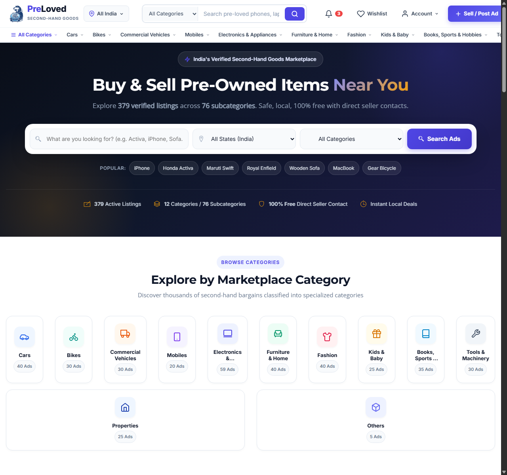
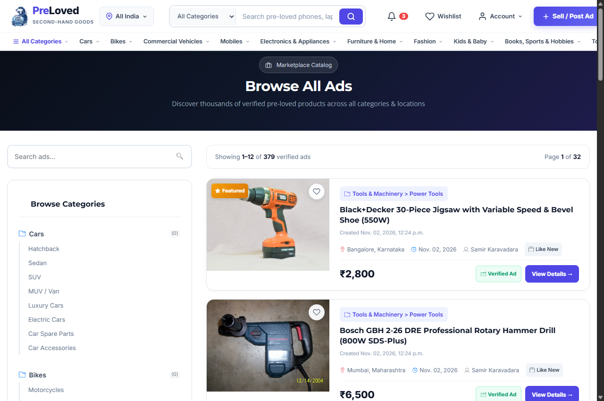
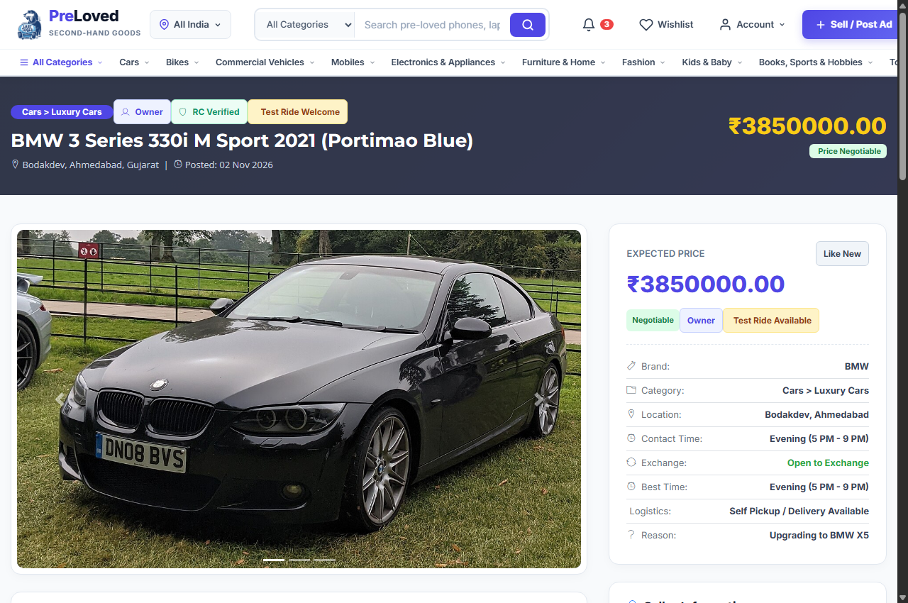
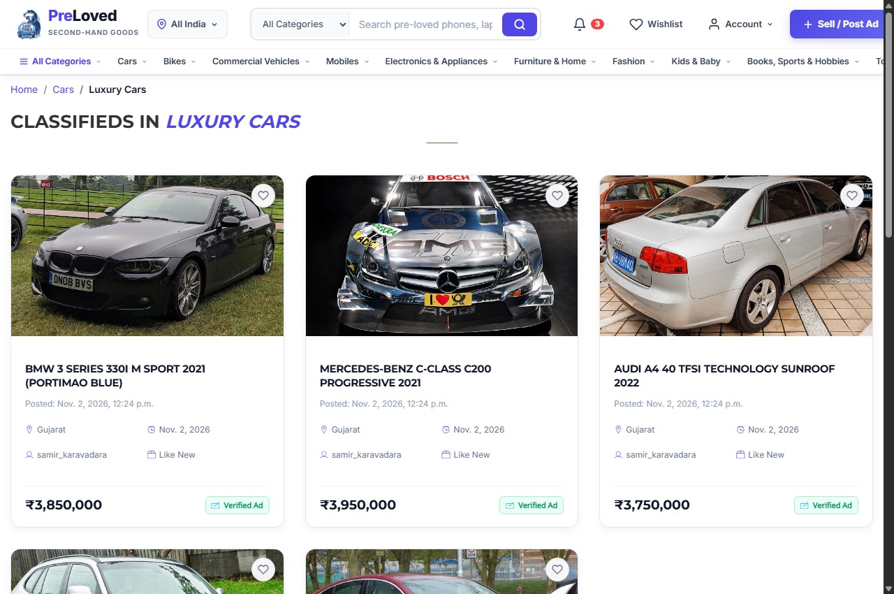
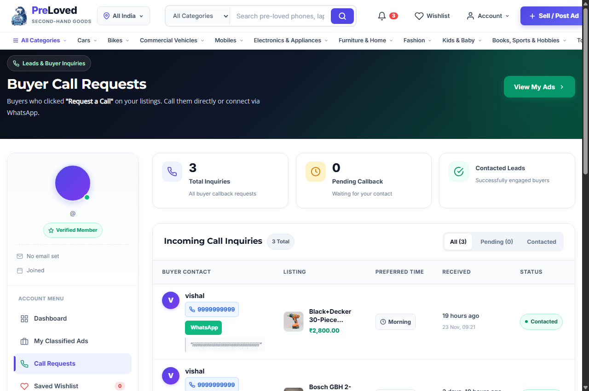
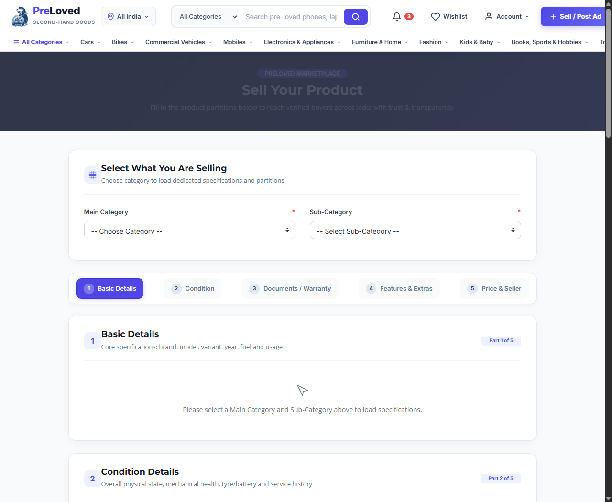
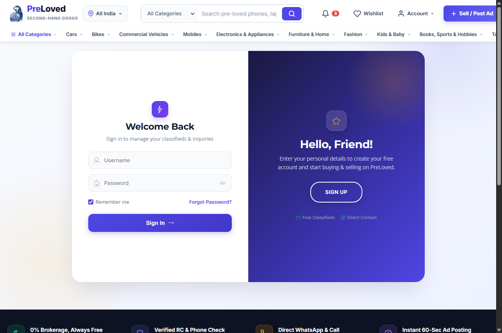
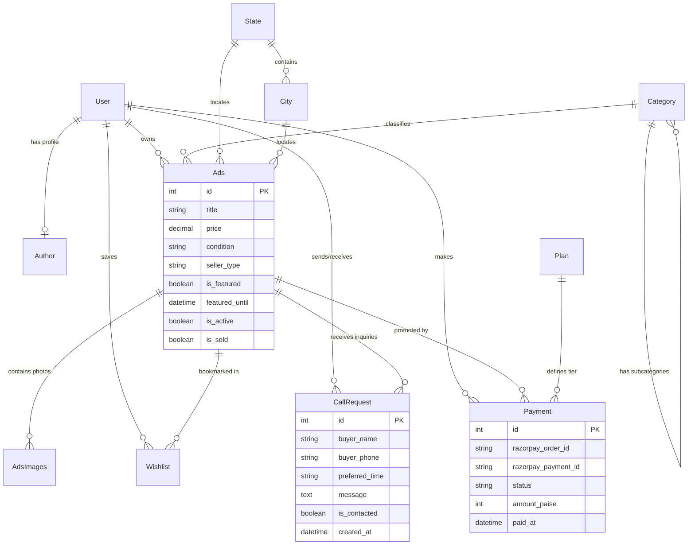

# PreLoved - Modern Pre-Owned Classifieds Marketplace

A full-stack, enterprise-grade peer-to-peer pre-owned classified ads platform built with Python, Django, Bootstrap, and Razorpay. PreLoved enables users to list, browse, search, and trade verified second-hand items—spanning Automobiles, Electronics, Furniture, Mobile Phones, and Industrial Machinery—with privacy-preserving callback leads and tiered monetization.

---

## Visual Showcase & Screenshots

### 1. Modern Homepage & Hyper-Local Category Hub
Search by keyword, filter across Indian states, and navigate structured categories.


---

### 2. Classifieds Catalog & Smart Filtering
Browse active listings with dynamic price displays, condition pills, and category tags.


---

### 3. Listing Detail Page with "Request a Call" Lead System
Structured technical specifications, seller profile verification, authentic product image carousel (showcasing BMW 3 Series 330i M Sport), and direct callback routing.


---

### 4. Category-Specific Catalog Archive
Tailored category views (such as Luxury Cars featuring verified BMW, Mercedes-Benz, and Audi vehicles) with deep filtering.


---

### 5. Seller Lead & Callback Management Dashboard
Dedicated seller dashboard (`/call-requests/`) tracking buyer inquiries with real-time counters, one-click WhatsApp integration, and "Mark Contacted" status toggling.


---

### 6. Multi-Step Listing Submission Studio
Seller studio featuring category-specific dynamic fields, document checks, and multi-photo upload validation.


---

### 7. Secure Authentication & Member Portal
Streamlined login and registration interface protected against open redirects and brute-force vectors.


---

## Core Features (A to Z)

- **A - Automobile & Document Verification**: Built-in support for vehicle listings including Fuel Type, KM Driven, Transmission, Ownership count, Registration State, RC (Registration Certificate) availability, and Test Ride flags.
- **B - Buyer Callback Lead Pipeline**: Replaces exposed phone numbers with an interactive **"Request a Call"** system. Captures buyer name, phone (+91 validation), preferred contact window (Morning, Afternoon, Evening, Anytime), and inquiry notes.
- **C - Category Architecture**: Two-tier hierarchical taxonomy with subcategories, category slugs, and dedicated archive pages.
- **D - Dynamic Specification Fields**: Dynamic JavaScript form generator that injects category-appropriate inputs (e.g. Engine/KM/RC for vehicles vs Screen/RAM/Storage for smartphones).
- **E - Email Notification Engine**: Integrated with Gmail SMTP via Google App Passwords to deliver real-time email alerts to sellers whenever a buyer requests a callback.
- **F - Featured Ad Monetization (Razorpay)**: Automated listing upgrades with 3 promotion plans:
  - **7-Day Fast Boost** (₹99)
  - **30-Day Premium Highlight** (₹249)
  - **90-Day VIP Feature** (₹599)
  - Features cryptographic HMAC-SHA256 signature verification and automatic expiration scheduling (`featured_until`).
- **G - Governance, Safety & XSS Sanitization**:
  - HTML body sanitization powered by `bleach` to prevent Stored Cross-Site Scripting (XSS).
  - Open redirect defense via Django's `url_has_allowed_host_and_scheme`.
  - Image MIME validation and 10MB size enforcement using Pillow header verification.
- **H - High-Performance Admin & Analytics Hub**: Custom administrative control center (`/admin/analytics/`) featuring platform telemetry, inventory trajectory metrics, category breakdowns, and Excel/CSV data exports.
- **I - Interactive Member Dashboard**: Control center for sellers to manage active, featured, and sold listings, track saved wishlists, and review leads.
- **L - Lead Management Dashboard (`/call-requests/`)**: Dedicated seller dashboard with live pending lead counts, click-to-call shortcuts, direct WhatsApp integration, and one-click "Mark Contacted" status toggling.
- **P - Photo Upload Engine**: Enforces a minimum of 3 and maximum of 10 photos per listing for quality assurance.
- **S - State & City Filtering**: Deep geographical filtering covering major Indian states and metropolitan cities.
- **W - Wishlist System**: Instant client-side AJAX wishlist bookmarking with count indicators.

---

## Technical Stack & Architecture

- **Backend**: Python 3.11+, Django 5.x
- **Database**: SQLite (Zero-dependency development) / PostgreSQL ready
- **Payment Gateway**: Razorpay Payments API (Order Creation, Verification, Webhooks)
- **Email Delivery**: Python `smtplib` via Google SMTP (`smtp.gmail.com:587` with TLS)
- **Frontend**: HTML5, Modern CSS, Bootstrap, JavaScript (ES6+), LineIcons
- **Security & Utilities**: `bleach` (HTML sanitization), `pillow` (image verification), `django-ckeditor`

---

## Database Schema (Entity-Relationship Diagram)



---

## Repository Directory Structure

```text
PreLoved-Django-P1/
├── ads/                        # Core Classifieds Application
│   ├── migrations/             # Database migrations (including 0036_callrequest)
│   ├── templates/ads/          # Templates (ads-detail, ads-listing, post-ads, wishlist)
│   ├── admin.py                # Admin declarations for Ads & CallRequests
│   ├── models.py               # Ads, Category, CallRequest, State, City models
│   ├── urls.py                 # Ad routing & request-call endpoint
│   └── views.py                # Ad posting, sanitized editing, detail, and search
├── authentication/             # User Authentication & Security
│   ├── forms.py                # Case-insensitive registration & profile forms
│   ├── urls.py                 # Login, signup, password reset routes
│   └── views.py                # Open-redirect safe authentication logic
├── custom_admin/               # Administrative Analytics & Telemetry
│   ├── templates/custom_admin/ # Custom analytics, telemetry, and moderation UI
│   ├── services.py             # Telemetry aggregations & reporting
│   └── views.py                # Export functions & management views
├── pages/                      # Static & Home Pages
│   ├── templates/pages/        # Index, FAQ, Contact, Terms
│   └── views.py                # Home page with category listing
├── payments/                   # Razorpay Monetization System
│   ├── templates/payments/     # Promotion checkout interface
│   ├── models.py               # Plan & Payment models
│   ├── urls.py                 # Payment endpoints (create order, verify, webhook)
│   └── views.py                # HMAC-SHA256 signature verification & sandbox fallback
├── profiles/                   # User Profile & Dashboard
│   ├── templates/profiles/     # Account dashboard, all-ads, call-requests, settings
│   ├── urls.py                 # Profile & lead management routes
│   └── views.py                # Dashboard metrics & lead status toggling
├── preloved/                   # Django Project Core Configuration
│   ├── settings.py             # Settings, .env loading, SMTP configuration
│   ├── urls.py                 # Master URL registry
│   └── wsgi.py                 # WSGI application entrypoint
├── docs/                       # Project Documentation & Assets
│   ├── DOCUMENTATION.md        # Technical specification & system architecture
│   └── screenshots/            # UI screenshots gallery
├── static/                     # Static CSS, JS, Vendor Icons, and SCSS
├── .env.example                # Sample environment variables template
├── .gitignore                  # Production Git ignore rules
├── manage.py                   # Django CLI management script
└── requirements.txt            # Python dependencies manifest
```

---

## Installation & Local Setup

### 1. Clone the Repository
```bash
git clone https://github.com/samir00777/Pre-Loved.git
cd Pre-Loved
```

### 2. Create and Activate Virtual Environment
```bash
# On Windows:
python -m venv venv
.\venv\Scripts\activate

# On macOS/Linux:
python3 -m venv venv
source venv/bin/activate
```

### 3. Install Required Dependencies
```bash
pip install -r requirements.txt
```

### 4. Configure Environment Variables
Copy the `.env.example` file to `.env`:
```bash
# On Windows:
copy .env.example .env

# On macOS/Linux:
cp .env.example .env
```

Open `.env` and configure your credentials:
```env
SECRET_KEY=your-django-secret-key
DEBUG=True

# Gmail SMTP Email Setup (for Call Request Notifications)
EMAIL_HOST_USER=your_email@gmail.com
EMAIL_HOST_PASSWORD=your_16_character_app_password
DEFAULT_FROM_EMAIL=PreLoved <your_email@gmail.com>

# Razorpay API Credentials (Optional - sandbox mode available by default)
RAZORPAY_KEY_ID=rzp_test_xxxxxxxxxxxx
RAZORPAY_KEY_SECRET=your_razorpay_secret
RAZORPAY_WEBHOOK_SECRET=your_webhook_secret
```

### 5. Apply Database Migrations
```bash
python manage.py migrate
```

### 6. Create an Administrative Superuser
```bash
python manage.py createsuperuser
```

### 7. Launch Development Server
```bash
python manage.py runserver
```

Open your web browser and navigate to:
```text
http://127.0.0.1:8000/
```

- Access the public marketplace: `http://127.0.0.1:8000/`
- Access your member dashboard: `http://127.0.0.1:8000/dashboard/`
- Access buyer callback leads: `http://127.0.0.1:8000/call-requests/`
- Access the custom admin analytics: `http://127.0.0.1:8000/admin/analytics/`

---

## Security Hardening Details

1. **Stored XSS Sanitization**:
   - All user-submitted listing descriptions are cleaned through `bleach.clean()` before persistence, allowing safe HTML tags while stripping `<script>`, `onerror`, `onload`, and malicious `javascript:` schemes.
2. **Open Redirect Defense**:
   - `login_view` and `signup_view` inspect the `?next=` query parameter via `url_has_allowed_host_and_scheme()` to prevent external phishing redirects.
3. **MIME & File Integrity Validation**:
   - Uploaded ad images are validated for size (under 10MB), extension allowlist (`.jpg`, `.jpeg`, `.png`, `.webp`, `.gif`), and structural validity via Pillow image header inspection.
4. **Secret Isolation**:
   - Real credentials, API keys, and email app passwords are fully isolated inside `.env` and kept strictly untracked by Git.

---

## License & Author

Developed by **Samir Karavadara** for the **PreLoved** marketplace project.  
Licensed under the MIT License.
